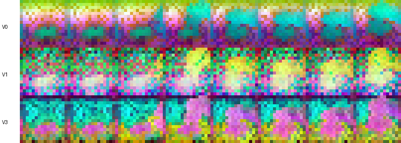
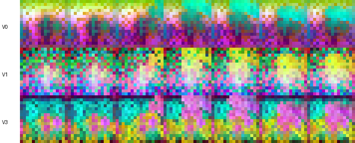
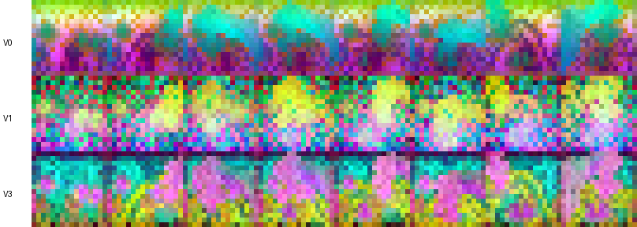

# Stage 1 probe report

Attention runs: 115 at the chosen lr (of 226); ridge runs: 32.

## 1. Main table (test nMSE, attention probe)

### P1s

| input | lr | seeds | test nMSE | arm | gripper | Δ vs V0 | 95% CI | significant |
|---|---|---|---|---|---|---|---|---|
| B-mean | - | 1 | 1.0018 | 1.0019 | 1.0016 | +0.9754 (+3992.0%) | [+0.9597, +0.9922] ([+3927.6%, +4060.7%]) | yes |
| B-pixel | 0.001 | 3 | 0.0411 ± 0.0009 | 0.0481 ± 0.0010 | 0.0277 ± 0.0008 | +0.0203 (+82.9%) | [+0.0140, +0.0258] ([+57.2%, +105.6%]) | yes |
| B-state | 0.001 | 3 | 0.0772 ± 0.0006 | 0.0929 ± 0.0006 | 0.0470 ± 0.0010 | +0.0537 (+219.8%) | [+0.0299, +0.0684] ([+122.5%, +279.8%]) | yes |
| V0 | 0.001 | 3 | 0.0244 ± 0.0001 | 0.0320 ± 0.0001 | 0.0099 ± 0.0003 |  |  |  |
| V1 | 0.001 | 3 | 0.0272 ± 0.0006 | 0.0345 ± 0.0010 | 0.0131 ± 0.0004 | +0.0029 (+11.9%) | [-0.0008, +0.0055] ([-3.3%, +22.3%]) | no |
| V1i | 0.001 | 3 | 0.0302 ± 0.0005 | 0.0376 ± 0.0010 | 0.0160 ± 0.0006 | +0.0067 (+27.6%) | [+0.0042, +0.0087] ([+17.1%, +35.6%]) | yes |
| V1m | 0.001 | 3 | 0.0259 ± 0.0007 | 0.0336 ± 0.0012 | 0.0112 ± 0.0004 | +0.0015 (+6.1%) | [-0.0012, +0.0034] ([-4.8%, +13.9%]) | no |
| V2 | 0.001 | 3 | 0.0217 ± 0.0008 | 0.0308 ± 0.0013 | 0.0043 ± 0.0001 | -0.0024 (-9.6%) | [-0.0044, +0.0002] ([-18.0%, +0.8%]) | no |
| V3 | 0.001 | 3 | 0.0261 ± 0.0015 | 0.0338 ± 0.0017 | 0.0114 ± 0.0009 | +0.0012 (+4.9%) | [-0.0029, +0.0037] ([-11.9%, +15.1%]) | no |
| V3h | 0.001 | 3 | 0.0247 ± 0.0014 | 0.0320 ± 0.0014 | 0.0106 ± 0.0013 | -0.0007 (-3.0%) | [-0.0057, +0.0021] ([-23.1%, +8.6%]) | no |

### P1

| input | lr | seeds | test nMSE | arm | gripper | Δ vs V0 | 95% CI | significant |
|---|---|---|---|---|---|---|---|---|
| B-mean | - | 1 | 1.0018 | 1.0019 | 1.0016 | +0.9514 (+2159.3%) | [+0.9352, +0.9681] ([+2122.5%, +2197.3%]) | yes |
| B-pixel | 0.001 | 3 | 0.1023 ± 0.0022 | 0.1120 ± 0.0027 | 0.0838 ± 0.0016 | +0.0737 (+167.2%) | [+0.0655, +0.0833] ([+148.6%, +189.1%]) | yes |
| B-state | 0.001 | 3 | 0.0772 ± 0.0006 | 0.0929 ± 0.0006 | 0.0470 ± 0.0010 | +0.0297 (+67.3%) | [+0.0018, +0.0465] ([+4.1%, +105.6%]) | yes |
| V0 | 0.0003 | 3 | 0.0441 ± 0.0020 | 0.0556 ± 0.0030 | 0.0220 ± 0.0001 |  |  |  |
| V1 | 0.001 | 3 | 0.0463 ± 0.0015 | 0.0587 ± 0.0021 | 0.0225 ± 0.0005 | +0.0036 (+8.1%) | [+0.0010, +0.0064] ([+2.2%, +14.5%]) | yes |
| V1i | 0.001 | 3 | 0.0588 ± 0.0080 | 0.0710 ± 0.0096 | 0.0356 ± 0.0049 | +0.0185 (+41.9%) | [+0.0129, +0.0255] ([+29.4%, +58.0%]) | yes |
| V1m | 0.001 | 3 | 0.0428 ± 0.0044 | 0.0543 ± 0.0054 | 0.0208 ± 0.0024 | -0.0018 (-4.1%) | [-0.0046, +0.0007] ([-10.4%, +1.7%]) | no |
| V2 | 0.001 | 3 | 0.0362 ± 0.0032 | 0.0503 ± 0.0045 | 0.0092 ± 0.0007 | -0.0062 (-14.0%) | [-0.0104, -0.0013] ([-23.6%, -3.0%]) | yes |
| V3 | 0.001 | 3 | 0.0380 ± 0.0003 | 0.0487 ± 0.0002 | 0.0173 ± 0.0005 | -0.0065 (-14.7%) | [-0.0093, -0.0042] ([-21.0%, -9.5%]) | yes |
| V3h | 0.001 | 3 | 0.0371 ± 0.0013 | 0.0474 ± 0.0015 | 0.0173 ± 0.0012 | -0.0077 (-17.5%) | [-0.0102, -0.0057] ([-23.1%, -13.0%]) | yes |

### P1d

| input | lr | seeds | test nMSE | arm | gripper | Δ vs V0 | 95% CI | significant |
|---|---|---|---|---|---|---|---|---|
| B-mean | - | 1 | 1.0001 | 1.0001 | 1.0001 | +0.9350 (+1599.5%) | [+0.8955, +0.9724] ([+1532.0%, +1663.5%]) | yes |
| B-pixel | 0.001 | 3 | 0.1851 ± 0.0060 | 0.1697 ± 0.0020 | 0.2033 ± 0.0107 | +0.1571 (+268.8%) | [+0.1426, +0.1710] ([+243.9%, +292.5%]) | yes |
| B-state | 0.001 | 3 | 0.1546 ± 0.0015 | 0.2420 ± 0.0017 | 0.0516 ± 0.0019 | +0.1062 (+181.6%) | [+0.0954, +0.1178] ([+163.2%, +201.4%]) | yes |
| V0 | 0.001 | 3 | 0.0585 ± 0.0027 | 0.0792 ± 0.0052 | 0.0340 ± 0.0002 |  |  |  |
| V1 | 0.001 | 3 | 0.0795 ± 0.0051 | 0.1001 ± 0.0074 | 0.0552 ± 0.0027 | +0.0248 (+42.3%) | [+0.0188, +0.0315] ([+32.1%, +53.9%]) | yes |
| V1i | 0.001 | 3 | 0.0866 ± 0.0018 | 0.1012 ± 0.0024 | 0.0693 ± 0.0010 | +0.0314 (+53.7%) | [+0.0184, +0.0413] ([+31.5%, +70.7%]) | yes |
| V1m | 0.001 | 3 | 0.0652 ± 0.0007 | 0.0854 ± 0.0018 | 0.0415 ± 0.0007 | +0.0055 (+9.4%) | [-0.0019, +0.0115] ([-3.2%, +19.7%]) | no |
| V2 | 0.001 | 3 | 0.0489 ± 0.0004 | 0.0827 ± 0.0007 | 0.0090 ± 0.0007 | -0.0100 (-17.1%) | [-0.0229, +0.0104] ([-39.2%, +17.8%]) | no |
| V3 | 0.001 | 3 | 0.0629 ± 0.0026 | 0.0824 ± 0.0039 | 0.0399 ± 0.0012 | +0.0035 (+5.9%) | [-0.0031, +0.0088] ([-5.3%, +15.0%]) | no |
| V3h | 0.001 | 3 | 0.0571 ± 0.0007 | 0.0776 ± 0.0011 | 0.0330 ± 0.0011 | -0.0046 (-7.9%) | [-0.0124, +0.0012] ([-21.1%, +2.1%]) | no |

### P2

| input | lr | seeds | test nMSE | arm | gripper | Δ vs V0 | 95% CI | significant |
|---|---|---|---|---|---|---|---|---|
| B-mean | - | 1 | 1.0015 | 1.0018 | 1.0010 | +0.8817 (+1318.3%) | [+0.8509, +0.9086] ([+1272.2%, +1358.4%]) | yes |
| B-pixel | 0.001 | 3 | 0.1702 ± 0.0077 | 0.0982 ± 0.0080 | 0.3191 ± 0.0076 | +0.1129 (+168.8%) | [+0.0865, +0.1348] ([+129.4%, +201.5%]) | yes |
| V0 | 0.001 | 3 | 0.0669 ± 0.0127 | 0.0604 ± 0.0152 | 0.0803 ± 0.0142 |  |  |  |
| V1 | 0.001 | 3 | 0.0440 ± 0.0011 | 0.0440 ± 0.0008 | 0.0441 ± 0.0019 | -0.0255 (-38.1%) | [-0.0511, -0.0060] ([-76.4%, -8.9%]) | yes |
| V1i | 0.0003 | 3 | 0.0787 ± 0.0050 | 0.0629 ± 0.0051 | 0.1114 ± 0.0053 | +0.0096 (+14.3%) | [-0.0159, +0.0308] ([-23.7%, +46.0%]) | no |
| V1m | 0.0003 | 3 | 0.0378 ± 0.0026 | 0.0401 ± 0.0036 | 0.0332 ± 0.0006 | -0.0331 (-49.4%) | [-0.0583, -0.0139] ([-87.2%, -20.8%]) | yes |
| V2 | 0.0003 | 3 | 0.0317 ± 0.0023 | 0.0412 ± 0.0030 | 0.0122 ± 0.0010 | -0.0394 (-59.0%) | [-0.0657, -0.0200] ([-98.3%, -30.0%]) | yes |
| V3 | 0.0003 | 3 | 0.0392 ± 0.0183 | 0.0428 ± 0.0215 | 0.0319 ± 0.0119 | -0.0325 (-48.6%) | [-0.0556, -0.0154] ([-83.1%, -23.0%]) | yes |
| V3h | 0.0003 | 3 | 0.0282 ± 0.0003 | 0.0295 ± 0.0014 | 0.0255 ± 0.0019 | -0.0434 (-64.9%) | [-0.0671, -0.0254] ([-100.3%, -37.9%]) | yes |

## 2. Gripper-event subset (test nMSE on samples whose chunk opens or closes a gripper)

### P1s

| input | lr | seeds | test nMSE |
|---|---|---|---|
| B-mean | - | 1 | 0.9668 |
| B-pixel | 0.001 | 3 | 0.0276 ± 0.0010 |
| B-state | 0.001 | 3 | 0.0547 ± 0.0003 |
| V0 | 0.001 | 3 | 0.0107 ± 0.0002 |
| V1 | 0.001 | 3 | 0.0142 ± 0.0004 |
| V1i | 0.001 | 3 | 0.0167 ± 0.0001 |
| V1m | 0.001 | 3 | 0.0121 ± 0.0004 |
| V2 | 0.001 | 3 | 0.0072 ± 0.0001 |
| V3 | 0.001 | 3 | 0.0125 ± 0.0013 |
| V3h | 0.001 | 3 | 0.0117 ± 0.0014 |

### P1

| input | lr | seeds | test nMSE |
|---|---|---|---|
| B-mean | - | 1 | 0.9668 |
| B-pixel | 0.001 | 3 | 0.0892 ± 0.0030 |
| B-state | 0.001 | 3 | 0.0547 ± 0.0003 |
| V0 | 0.0003 | 3 | 0.0254 ± 0.0014 |
| V1 | 0.001 | 3 | 0.0283 ± 0.0009 |
| V1i | 0.001 | 3 | 0.0423 ± 0.0088 |
| V1m | 0.001 | 3 | 0.0254 ± 0.0054 |
| V2 | 0.001 | 3 | 0.0192 ± 0.0029 |
| V3 | 0.001 | 3 | 0.0203 ± 0.0008 |
| V3h | 0.001 | 3 | 0.0194 ± 0.0015 |

## 3. P3: predictability of the future target

| input | R² cur | R² cur+act | ΔR² |
|---|---|---|---|
| B-pixel | 0.365 | 0.575 | +0.210 |
| V0 | 0.777 | 0.832 | +0.055 |
| V1 | 0.848 | 0.854 | +0.006 |
| V1i | 0.606 | 0.658 | +0.053 |
| V1m | 0.791 | 0.798 | +0.007 |
| V2 | 0.790 | 0.809 | +0.019 |
| V3 | 0.841 | 0.848 | +0.007 |
| V3h | 0.845 | 0.852 | +0.007 |

## 4. P4: V0 concatenated with JEPA (P1s)

| input | test nMSE | alone | Δ vs V0 | 95% CI | significant |
|---|---|---|---|---|---|
| V0+V1m | 0.0276 ± 0.0019 | 0.0259 ± 0.0007 | +0.0037 (+15.1%) | [+0.0025, +0.0051] ([+10.2%, +20.8%]) | yes |
| V0+V2 | 0.0221 ± 0.0006 | 0.0217 ± 0.0008 | -0.0013 (-5.5%) | [-0.0042, +0.0033] ([-17.0%, +13.4%]) | no |

## 5. P5: teacher cost (batch 64, bf16, NVIDIA B300 SXM6 AC)

| variant | ms/batch | p90 ms | compiled ms | peak GB | StepTime ×, both | StepTime ×, replace | extra frames | decode worker share |
|---|---|---|---|---|---|---|---|---|
| V0 | 326.1 | 453.2 | 238.8 | 3.2 | 1.097 | - | 0 | 0% |
| V1 | 170.7 | 195.2 | 108.2 | 3.3 | 1.051 | 0.954 | 0 | 0% |
| V1i | 177.8 | 215.8 | 100.6 | 3.4 | 1.053 | 0.956 | 0 | 0% |
| V2 | 359.7 | 379.6 | 187.3 | 5.6 | 1.107 | 1.010 | 5 | 24% |
| V3 | 206.9 | 212.7 | 97.4 | 4.1 | 1.062 | 0.965 | 0 | 0% |
| V3h | 381.5 | 452.2 | 211.2 | 6.0 | 1.114 | 1.016 | 0 | 0% |

## 6. Linear vs attention probe ranking

| task | inputs | Spearman ρ |
|---|---|---|
| P1s | 8 | 0.98 |
| P1 | 8 | 0.74 |
| P1d | 8 | 0.93 |
| P2 | 8 | 0.74 |

## 7. PCA of current-frame tokens

